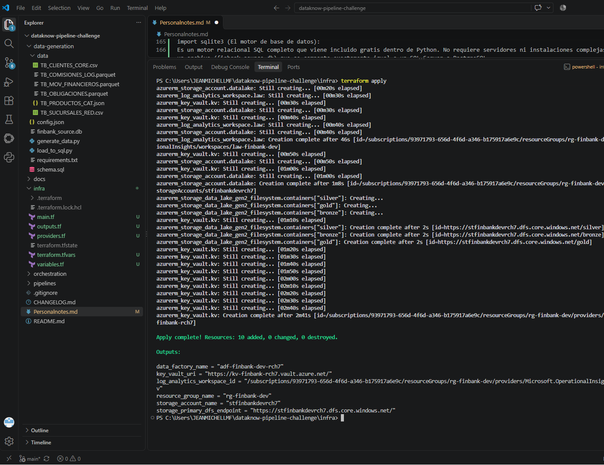
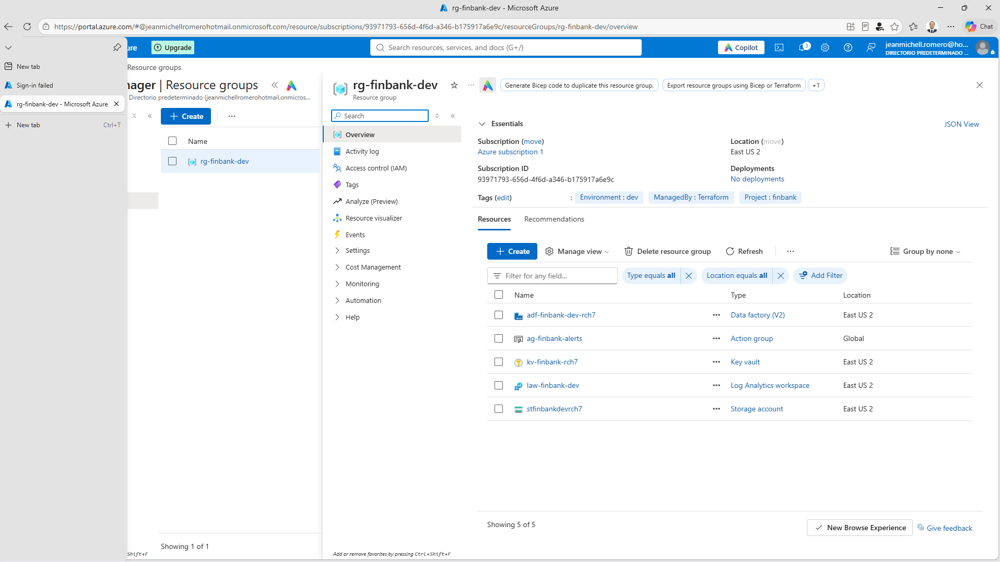
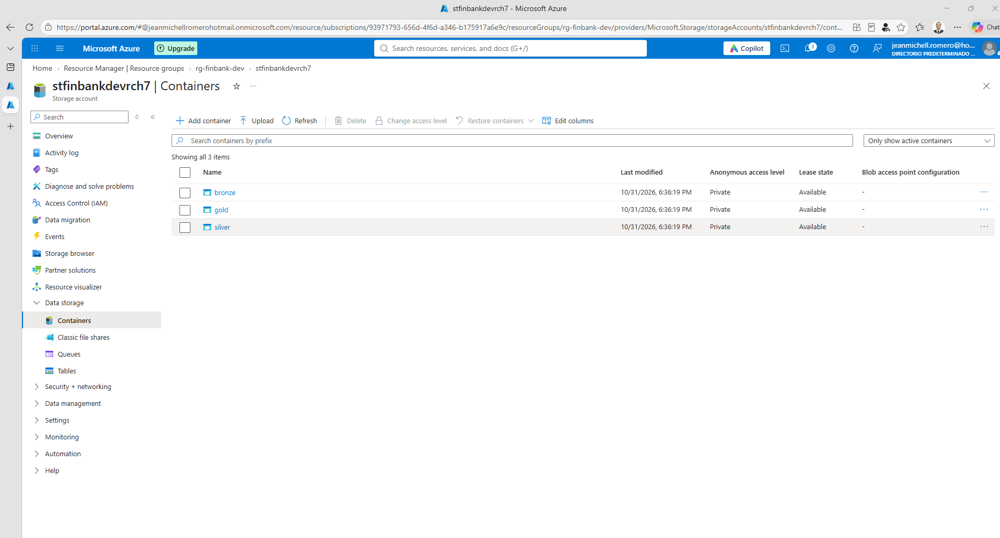

# Evidencias de Despliegue en Nube - Fase 2 (IaC Azure)

Aprovisionamiento automatizado mediante Terraform de la infraestructura para FinBank S.A. en Microsoft Azure (Región: `eastus2`, Ambiente: `dev`).

### 1. Salida de Terminal (`terraform apply`)
Ejecución exitosa del despliegue con 10 recursos creados y exportación de outputs sin errores:

### 2. Entorno en Microsoft Azure Portal
Grupo de recursos `rg-finbank-dev` activo con los servicios aprovisionados y sus etiquetas de gobernanza (*Tags*):

### 3. Contenedores del Data Lake (ADLS Gen2)
Estructura de almacenamiento con los 3 contenedores de la Arquitectura Medallón listos para ingesta:
