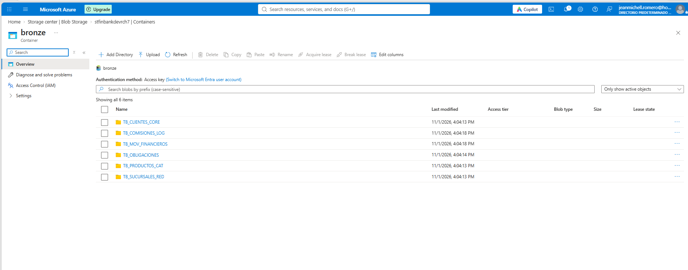
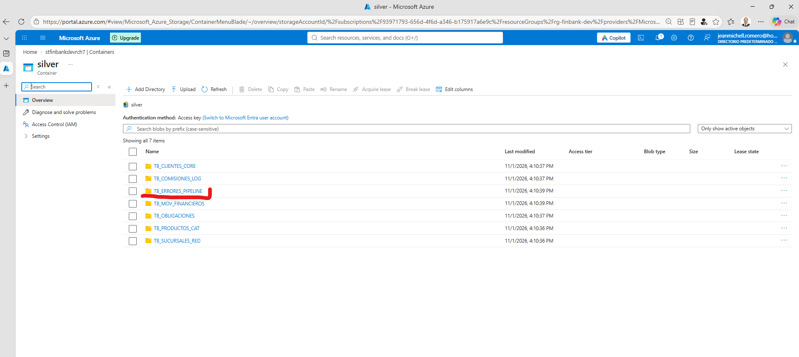
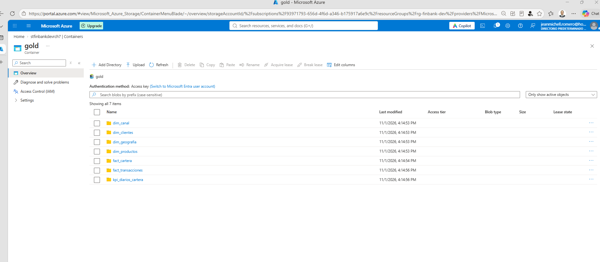

# Evidencias de Pipeline Medallón - Fase 3 (Bronze, Silver, Gold)

Implementación end-to-end de la Arquitectura Medallón sobre Microsoft Azure Data Lake Storage Gen2 para FinBank S.A.

### 1. Ingesta Capa Bronze
Datos crudos con metadatos de auditoría (`fecha_ingesta`, `sistema_fuente`, `id_lote`) y particionamiento por fecha:

### 2. Transformación Capa Silver
Limpieza de duplicados, aislamiento de anomalías en `TB_ERRORES_PIPELINE`, enmascaramiento con SHA-256 y detección de fraudes:

### 3. Modelo Dimensional y Agregaciones Gold
Modelo analítico en estrella con dimensiones, hechos, cálculo de provisiones de cartera y tabla agregada de KPIs ejecutivos:

### 4. Reporte de Pruebas Automatizadas de Calidad (Data Quality)
Ejecución automatizada de 5 pruebas de integridad, no nulidad y unicidad:
* **TEST 1 (No Nulos en PK Clientes):** APROBADO [PASS] ✔
* **TEST 2 (Saldos No Negativos):** APROBADO [PASS] ✔
* **TEST 3 (Rango Válido de Provisiones 0-100%):** APROBADO [PASS] ✔
* **TEST 4 (Integridad Referencial sin Huérfanos):** APROBADO [PASS] ✔
* **TEST 5 (Unicidad de Llave Primaria):** APROBADO [PASS] ✔
* **Resultado:** 5/5 Pruebas Exitosas (100% Calidad de Datos).