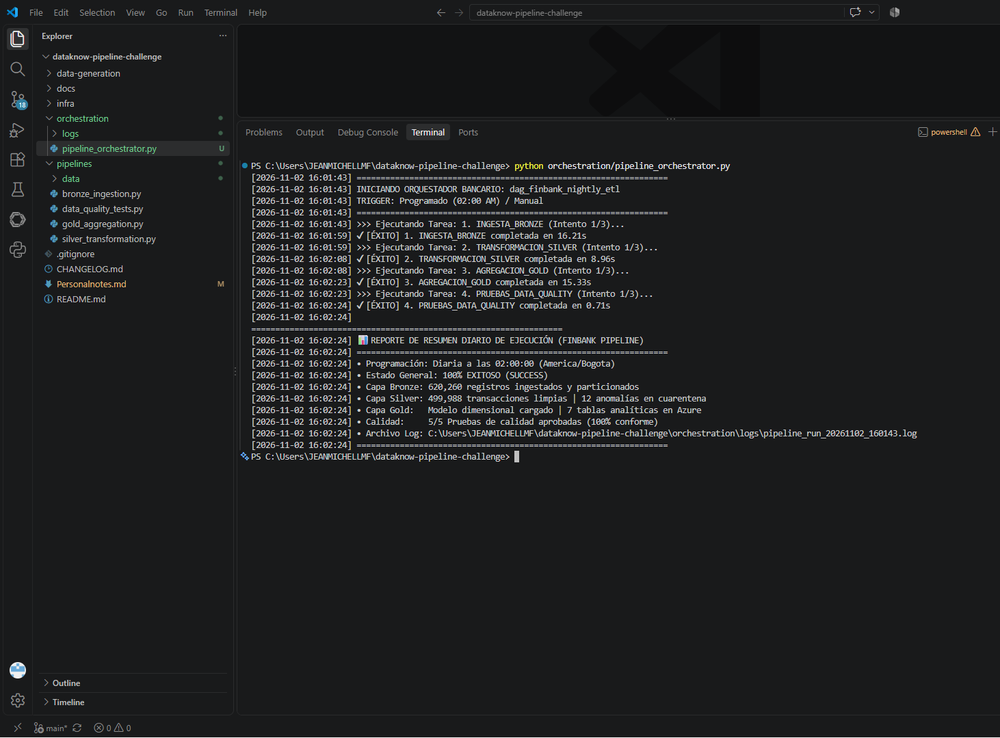

# Evidencias de Orquestación - Fase 4 (DAG y Flujo de Trabajo)

Orquestación secuencial automatizada del pipeline bancario FinBank (`dag_finbank_nightly_etl`).

### 1. Ejecución Secuencial del DAG y Reporte Diario
Flujo con dependencias estrictas (Bronze ➔ Silver ➔ Gold ➔ Data Quality), política de 3 reintentos con backoff exponencial y reporte de resumen operativo:

### 2. Parámetros Operacionales
* **Trigger Programado:** `02:00:00 AM (America/Bogota)`
* **Manejo de Reintentos:** Máximo 3 intentos por tarea con intervalo exponencial ($2^n$ segundos).
* **Trazabilidad:** Archivos de log generados en `/orchestration/logs/` accesibles para auditoría sin requerir inspección del código fuente.